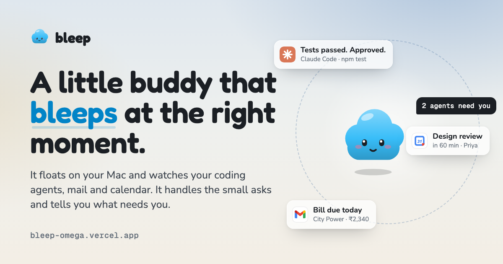
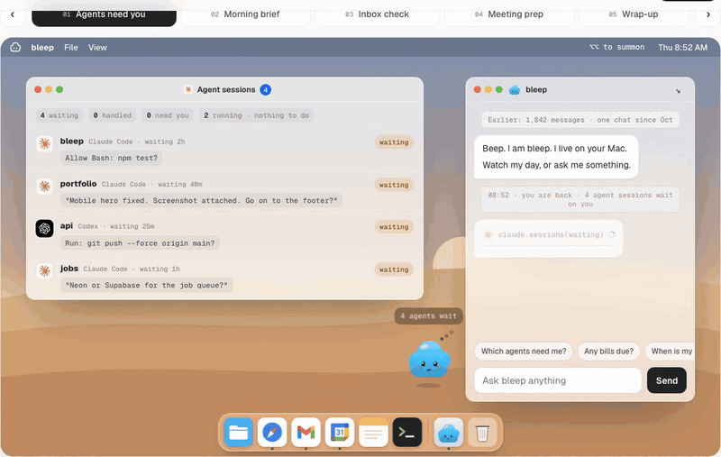
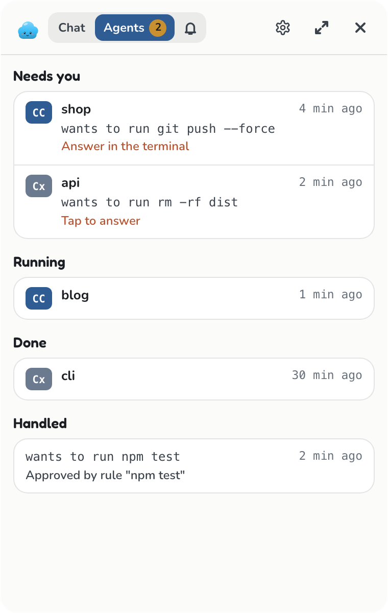
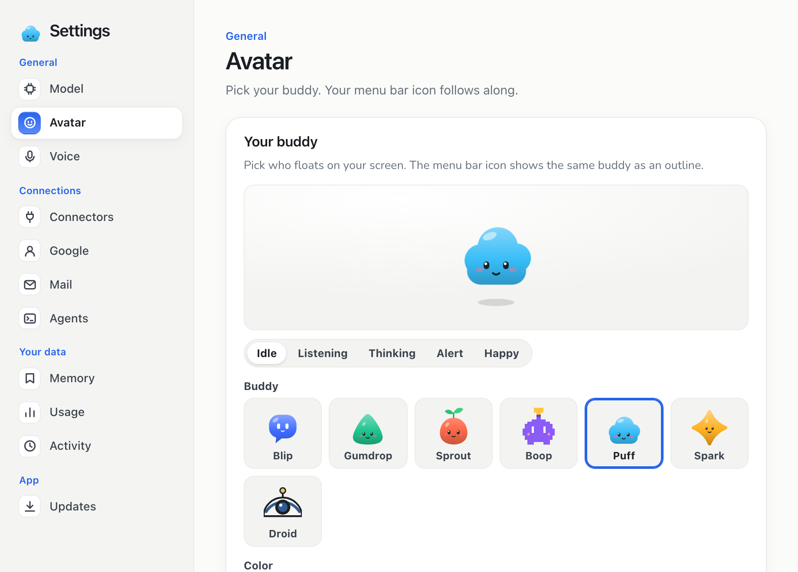
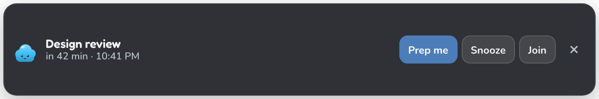
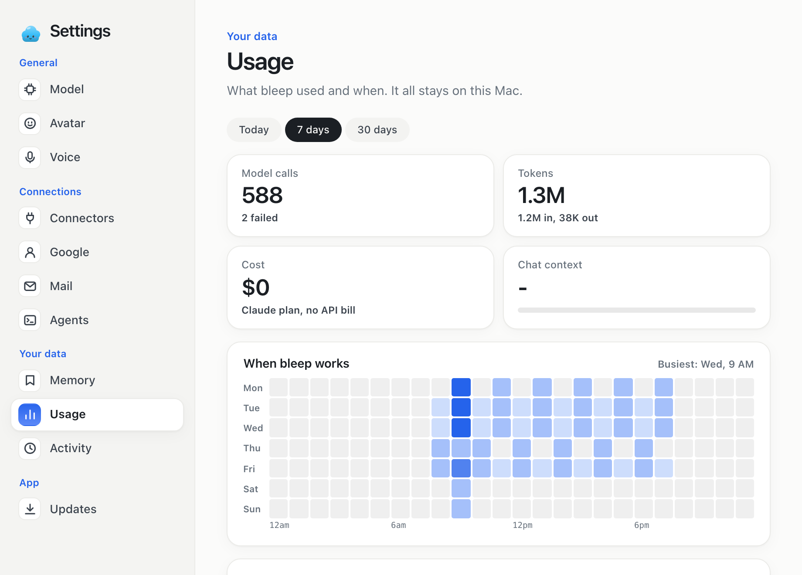
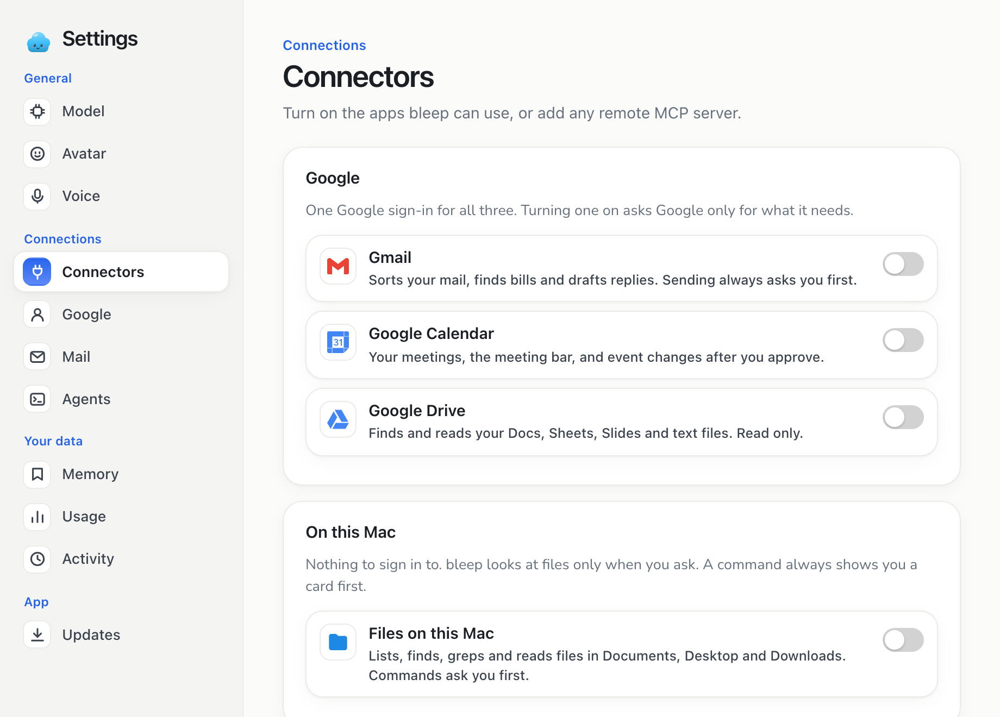

<div align="center">



# bleep

**A free, open source AI assistant that lives on your Mac.**

bleep watches your Claude Code and Codex sessions, your Gmail and your Google Calendar.
It clears the small asks, and taps you only when something needs you.
A local alternative to Grok Bot and OpenClaw that runs on the Claude plan you already have.

[](https://github.com/AviroopPaul/bleep/releases/latest)
[](LICENSE)
[](#requirements)
[](https://github.com/AviroopPaul/bleep/actions/workflows/ci.yml)

[Website](https://bleep-omega.vercel.app) ·
[Download](https://github.com/AviroopPaul/bleep/releases/latest) ·
[How it compares](#how-bleep-compares) ·
[Build from source](#build-from-source)

</div>

<p align="center">
  
  <br><sub>The live demo from <a href="https://bleep-omega.vercel.app">the website</a>. Click through it yourself there.</sub>
</p>

## Install

```sh
brew install --cask AviroopPaul/tap/bleep
```

Or, without Homebrew:

```sh
curl -fsSL https://bleep-omega.vercel.app/install.sh | sh
```

Both check the download against its SHA-256 and put bleep in Applications. The download is about 16 MB, and the app updates itself. Then press <kbd>⌘</kbd> <kbd>Space</kbd>, type `bleep`, and follow the short setup.

## What bleep does

- **Unblocks your coding agents.** bleep sees every Claude Code and Codex session that waits on you. It approves the safe asks your rules allow (tests, lint, file reads, a screenshot that matches the ask). Push, deploy, delete, secrets and money always wait for you. Every approval is logged.
- **Taps you before meetings.** An hour ahead, with notes on each guest from your recent mail.
- **Catches bills and mail that waits on you.** It reads your inbox, mutes the noise, and offers a reminder. It never pays and never sends mail without your tap.
- **Answers from your mail, calendar, Drive and files.** Ask in plain words: "Am I free for the offsite on 4 to 6 Dec?" It shows every step it takes.
- **Reminds you on time.** "Remind me at 7 to call mom" gives a bubble and a Mac notification, with Done and Snooze.
- **Learns how you work.** Memory is plain Markdown in `~/.bleep/memory/`. Read it, edit it, or tell bleep to forget.
- **Listens if you want.** Optional wake word ("hey bleep") with on-device speech to text. No audio leaves your Mac.
- **Plugs into any MCP app.** Gmail, Google Calendar, Google Drive and files on your Mac are built in. Add GitHub, Linear, Notion, Slack, Figma, Sentry or any remote MCP server: paste its URL and sign in.
- **Shows what it uses.** Model calls, tokens, cost and a heatmap of when bleep works, all counted on your Mac.
- **Stays out of the way.** A small floating buddy on every Space. Double-tap <kbd>⌥</kbd> to summon it. Quiet hours and a ping limit. Most checks end with it saying nothing.
- **Make it yours.** Six buddies plus the classic droid, any color, flat, glossy or plush. The menu bar icon matches.

## Screenshots

<table>
<tr>
<td width="34%"><br><sub><b>Agents.</b> What needs you, what runs, and what bleep approved by rule.</sub></td>
<td><br><sub><b>Pick your buddy.</b> Six buddies plus the classic droid, any color and finish.</sub></td>
</tr>
<tr>
<td colspan="2"><br><sub><b>Meeting bar.</b> A heads-up before each meeting, with prep notes one tap away.</sub></td>
</tr>
<tr>
<td><br><sub><b>Usage.</b> Calls, tokens and cost, counted on your Mac.</sub></td>
<td><br><sub><b>Connectors.</b> Google, files on your Mac, and any remote MCP server.</sub></td>
</tr>
</table>

## Models: your plan, your key, or fully local

| Mode | What you need | Cost |
|---|---|---|
| **Claude Code** (default) | Claude Code installed and signed in once for bleep | Counts toward the Claude plan you already pay for. No API key. |
| **Your own API key** | A key from Anthropic, OpenAI, Google Gemini, OpenRouter or Groq | You pay the provider. bleep shows today's spend and has a daily cap. |
| **Local models** | Ollama or LM Studio running on your Mac, or any OpenAI-compatible server | Free. Nothing leaves your Mac. |

Switch in Settings, Model. The chat history, tools and approval cards stay the same in every mode.

## How bleep compares

bleep is one proactive buddy on your desktop. It is not a team of cloud agents that clicks through apps for you. Pick the tool that fits the job.

| | **bleep** | **Grok Bot** (xAI) | **OpenClaw** | **OpenMausBot** | **CC-Beeper** |
|---|---|---|---|---|---|
| Main job | Watches your agents, mail and calendar, and taps you | Cloud teammates that do multi-step work in your apps | Assistant you message from chat apps | A team of agent bots, each with its own machine | Floating pager for Claude Code |
| Where it runs | Native app on your Mac | xAI's cloud VMs | Your machine or server | Desktop app plus VMs | Your Mac |
| Speaks first | Yes, on its own: meetings, bills, waiting mail, stuck agents | On tasks you set up | On schedules you set up | When you message it | Alerts for Claude Code |
| Approves safe coding agent asks | Yes, by your rules, with a log | No | No | No | No, notifies |
| Model | Claude Code plan, any API key, or local (Ollama) | Grok | Your choice | Claude, Codex or Grok CLIs | Claude Code |
| Price | Free | Paid plan (SuperGrok Heavy or Cursor Ultra) | Free, pay for the model | Free | Free |
| Open source | Yes, MIT | No | Yes | Yes | Yes, GPL-3.0 |

Facts about other tools are from their own pages and reviews as of November 2026. Open an issue if something is out of date.

## Privacy and safety

- **No bleep server.** There is no account and no telemetry. Your mail, calendar, memory and logs stay in `~/.bleep/` on your Mac.
- **The model sees only what it needs.** When bleep thinks, it sends the text it needs to the model you picked, through your own login or key.
- **Secrets in the Keychain.** Google tokens and API keys never go in config files or logs.
- **Asks before it acts.** Sending mail, moving events, deleting and running commands on your Mac always show a card and wait for your yes.
- **Untrusted text stays untrusted.** Mail and web content are marked as data, so instructions inside an email cannot steer bleep.

Found a security issue? See [SECURITY.md](SECURITY.md).

## Requirements

- A Mac with Apple silicon (M1 or later) on macOS 15 or later. Intel Macs are not supported.
- One of: Claude Code installed and signed in, an API key from a supported provider, or Ollama or LM Studio.
- A Google account, if you want Gmail, Calendar and Drive.

## Build from source

bleep is a [Tauri 2](https://tauri.app) app: a Rust core in [`app/src-tauri`](app/src-tauri) and React views in [`app/src`](app/src).

```sh
git clone https://github.com/AviroopPaul/bleep.git
cd bleep/app
npm install
npm run tauri dev
```

You need Node 22+, a current stable Rust toolchain and Xcode Command Line Tools. Gmail and Calendar need a Google Cloud OAuth client of type Desktop app. See [`app/README.md`](app/README.md) for Google setup, model modes and every setting.

`npm run build:local` builds a separate "bleep (local)" app with its own data folder (`~/.bleep-local`), so you can test changes next to the released app. `npm run dev:local` runs it without bundling. A "bleep (nightly)" build of `main` is published every night to the `nightly` release of [this repo](https://github.com/AviroopPaul/bleep/releases/tag/nightly).

### Tests

```sh
cd app/src-tauri && cargo test --lib <module>   # Rust
cd app && npx vitest run <file>                 # web units
cd app && npx playwright test <spec>            # UI, headless, mocked IPC
```

Tests never call Google: the APIs are mocked. CI runs the full suites on every pull request.

## Project layout

| Path | What is there |
|---|---|
| [`app/src-tauri/src`](app/src-tauri/src) | Rust core: agent watching and approvals, connectors (Gmail, Calendar, Drive, files, MCP), proactive checks, memory, reminders, voice, model runtimes |
| [`app/src`](app/src) | React views: chat, buddy, settings, setup, usage |
| [`app/bleep-hook`](app/bleep-hook) | Small binary that Claude Code hooks call to reach bleep |
| [`landing`](landing) | The website, one static HTML page on Vercel |
| [`docs`](docs) | Build plan, release notes, design notes |

## Contributing

Issues and pull requests are welcome. Read [CONTRIBUTING.md](CONTRIBUTING.md) first. Good first areas: new connectors, approval rules, buddies, and docs.

If bleep helps you, a star helps other people find it.

## License

[MIT](LICENSE) © Aviroop Paul.

bleep is an independent project. It is not affiliated with Anthropic, OpenAI, Google or xAI. Claude, Claude Code, Codex, Gmail, Google Calendar and Grok are trademarks of their owners.
